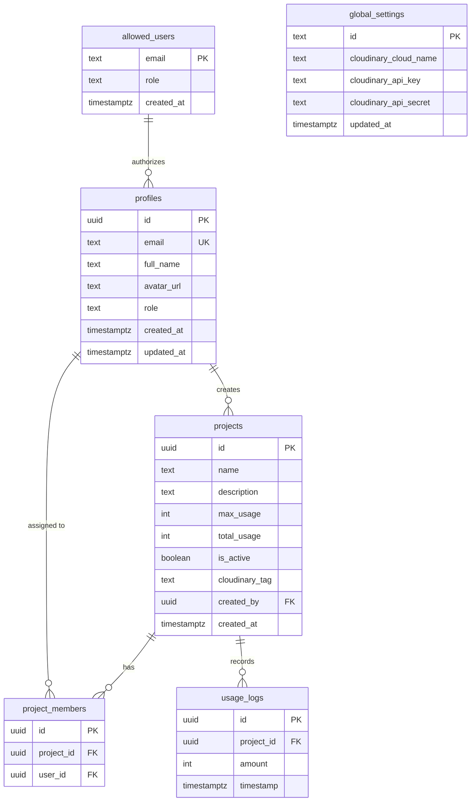
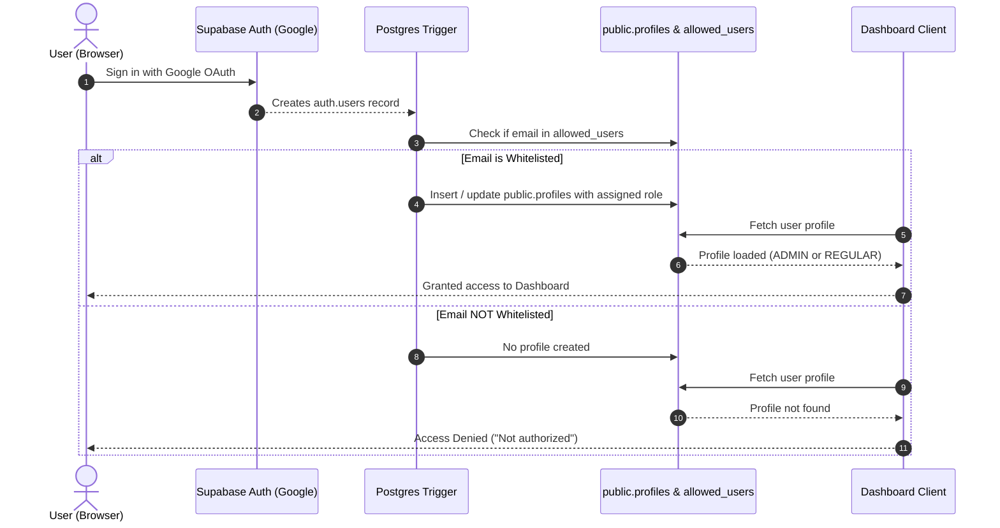

# AI Photobooth Console & Dashboard

Enterprise Photobooth Management, Monitoring, and Asset Distribution Dashboard. Built with **Next.js 16 (App Router)**, **TypeScript**, **Tailwind CSS**, **Supabase (PostgreSQL + Auth + RLS)**, and **Cloudinary**.

---

## 🚀 Key Features

- **Project & Event Management**:
  - Create and configure isolated photo booth projects/events.
  - Set daily usage quotas and limits per project with visual capacity indicators.
  - Real-time generation counters with atomic tracking.

- **Cloudinary Asset Pipeline**:
  - Live gallery synchronization filtered by asset tags or event folders.
  - Granular image inspector showing dimensions, format, upload date, metadata, and context.
  - Curated **Featured Images** collection management directly from the console.
  - Single and bulk asset downloads with formatted filenames (`{folder}-{date}-{id}`).

- **Secure Role-Based Access Control (RBAC)**:
  - Google OAuth authentication.
  - Strict database-enforced **Invite-Only Whitelist (`allowed_users`)**. Unwhitelisted Google accounts cannot access the system.
  - Roles:
    - **`ADMIN` (Super Admin)**: Full platform control, user whitelisting, global Cloudinary configuration, project creation/deletion, team member assignment.
    - **`REGULAR`**: Restricted access to assigned projects and operational views.

- **Multi-Device Global Sync**:
  - Cloudinary credentials and global infrastructure settings stored securely in Supabase.
  - Settings changes synchronize instantly across all admin sessions and production deployments.

- **Automated Generation Tracking API**:
  - High-performance API endpoint (`/api/projects/[id]/generate`) for photobooth hardware/kiosks to increment usage counters and log generation events atomically via PostgreSQL stored procedures.

---

## 🛠️ Tech Stack

| Layer | Technology |
| :--- | :--- |
| **Framework** | [Next.js 16](https://nextjs.org/) (App Router, Turbopack) |
| **UI & Styling** | React 19, TypeScript, [Tailwind CSS](https://tailwindcss.com/), [Lucide React](https://lucide.dev/) |
| **Charts & Metrics** | [Recharts](https://recharts.org/) |
| **Database & Auth** | [Supabase](https://supabase.com/) (PostgreSQL 15+, Row Level Security, Database Triggers, PL/pgSQL RPC) |
| **Media Storage** | [Cloudinary v2 SDK](https://cloudinary.com/) |

---

## 📁 Repository Structure

```text
├── app/
│   ├── api/
│   │   ├── cloudinary/
│   │   │   ├── images/route.ts       # Cloudinary search API with folder/tag filter
│   │   │   └── tags/route.ts         # Add/remove tags (e.g., 'Featured')
│   │   └── projects/[id]/
│   │       └── generate/route.ts     # Generation tracking API (RPC + usage log)
│   ├── login/page.tsx                # Google OAuth sign-in screen
│   ├── projects/
│   │   ├── page.tsx                  # Projects directory & creation modal
│   │   └── [id]/page.tsx             # Project detail, gallery, members & metrics
│   ├── settings/page.tsx             # Global Cloudinary settings manager (Admin)
│   ├── users/page.tsx                # Whitelist & active user access control (Admin)
│   ├── layout.tsx                    # Root layout with fonts & metadata
│   └── page.tsx                      # Main overview analytics dashboard
├── components/
│   ├── AuthContext.tsx               # Supabase session & user profile provider
│   └── ClientRootLayout.tsx          # Navigation sidebar & permission guards
├── scripts/
│   └── verify-supabase.js            # Automated verification test script for Supabase DB
├── supabase/
│   ├── schema.sql                    # Complete consolidated PostgreSQL schema & triggers
│   └── migrations/
│       └── 20240101000000_initial_schema.sql # Version-controlled initial migration
├── utils/
│   └── supabase.ts                   # Supabase browser client initialization
├── types.ts                          # TypeScript models, interfaces & UserRole enum
├── store.ts                          # Legacy fallback store definitions
└── .env.local                        # Local environment variables (git-ignored)
```

---

## ⚡ Quick Start

### 1. Prerequisites

- **Node.js** 18.18+ (Node.js 20+ or 22+ recommended)
- **npm**, **pnpm**, or **yarn**
- A **Supabase** account & project
- A **Cloudinary** account

### 2. Install Dependencies

```bash
npm install
```

### 3. Configure Environment Variables

Create or update `.env.local` in the project root:

```env
# Supabase Configuration
NEXT_PUBLIC_SUPABASE_URL=https://<your-project-ref>.supabase.co
NEXT_PUBLIC_SUPABASE_ANON_KEY=eyJhbGciOi...
SUPABASE_SERVICE_ROLE_KEY=eyJhbGciOi...

# Optional Gemini API Key (if generative features are enabled)
GEMINI_API_KEY=your_gemini_api_key_here
```

> **Security Note:** `SUPABASE_SERVICE_ROLE_KEY` is only used on the server side (in API routes and maintenance scripts) and is never exposed to client browsers.

### 4. Database Setup & Migrations

If setting up on a new Supabase instance:

1. Open your Supabase project's **SQL Editor**:
   `https://supabase.com/dashboard/project/<your-project-ref>/sql/new`
2. Copy the entire contents of [`supabase/schema.sql`](./supabase/schema.sql) into the editor.
3. Click **Run**.
4. Run the automated verification script to confirm tables, RPC, triggers, and admin access:

```bash
node --env-file=.env.local scripts/verify-supabase.js
```

### 5. Run the Local Development Server

```bash
npm run dev
```

The application runs by default on **[http://localhost:4000](http://localhost:4000)** (configured via `package.json`).

---

## 🗄️ Database Architecture

The system uses 6 core tables in the `public` schema with comprehensive Row Level Security (RLS):



### Key Database Components

1. **`public.allowed_users` (Whitelist)**:
   - Stores pre-authorized email addresses with designated roles (`ADMIN` or `REGULAR`).
   - Managed by Super Admins through the `/users` dashboard page.

2. **`public.profiles`**:
   - Represents registered users synced with `auth.users`.
   - References `auth.users(id)` with cascading deletion.

3. **`public.global_settings`**:
   - Stores platform-wide Cloudinary credentials in the single row `id = 'current'`.
   - Publicly readable by authenticated and client routes; editable only by `ADMIN`.

4. **`public.projects` & `public.project_members`**:
   - Isolates events and gallery tags.
   - Non-admin users can only view and manage projects they created or have been assigned to.

5. **`public.usage_logs`**:
   - Time-series log of all generation events with timestamps.

### Functions and Triggers

- **`increment_project_usage(p_id, p_amount)` (RPC)**:
  Atomically increments `projects.total_usage` by `p_amount` within a database transaction.
- **`handle_new_user()` (Trigger)**:
  Fires `AFTER INSERT OR UPDATE ON auth.users`. Checks if the signing-in user's email exists in `allowed_users`. If authorized, creates/updates their `public.profiles` entry with their assigned role.
- **`handle_allowed_user_change()` (Trigger)**:
  Fires `AFTER INSERT OR UPDATE ON public.allowed_users`. If the user already registered in `auth.users`, synchronizes their role immediately into `public.profiles`.
- **`is_admin()` (Helper)**:
  Security definer function used across RLS policies to evaluate whether the calling user has `ADMIN` privileges without triggering recursion.

---

## 🔒 Access Control & Whitelist Flow



---

## 🌐 External API Integration

### Incremental Generation Count (Hardware Kiosk Integration)

Kiosks and photobooth apps record generations by sending an HTTP POST request:

```http
POST /api/projects/:projectId/generate
Content-Type: application/json
```

**Response (`200 OK`)**:
```json
{
  "success": true,
  "projectId": "123e4567-e89b-12d3-a456-426614174000",
  "incrementedBy": 1,
  "timestamp": "2026-09-23T18:00:00.000Z"
}
```

---

## 🧪 Testing & Verification

Run the verification test script at any time to validate database health:

```bash
node --env-file=.env.local scripts/verify-supabase.js
```

Build validation:

```bash
npm run build
```

---

## 🚢 Production Deployment

When deploying to [Vercel](https://vercel.com/) or another cloud provider:

1. Connect the Git repository.
2. In Project Settings > Environment Variables, provide:
   - `NEXT_PUBLIC_SUPABASE_URL`
   - `NEXT_PUBLIC_SUPABASE_ANON_KEY`
   - `SUPABASE_SERVICE_ROLE_KEY`
   - `GEMINI_API_KEY` (if used)
3. Ensure Supabase Auth redirect URLs include your production domain:
   - Navigate to **Supabase Dashboard > Authentication > URL Configuration**.
   - Add `https://<your-production-domain>/` to **Redirect URLs**.
